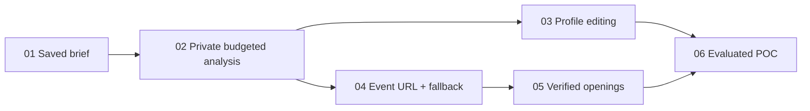

# EventSignal POC — Ticket implementation status

**Source:** [Product requirements document](PRD.md)  
**Date:** October 9, 2026  
**Status:** All six tickets authorized for implementation on October 9, 2026. Application implementation is present; paid-provider and real-source end-to-end validation remain pending by user instruction. No external deployment or tracker publication occurred. See [evaluation](EVALUATION.md).

Each ticket is an end-to-end slice with acceptance criteria and its own verification. No separate infrastructure-only, UI-only, or test-only ticket is needed. There is no existing code to prefactor.

| Ticket | Deliverable | Blocked by |
|---|---|---|
| [01 — Saved opportunity brief](../.scratch/eventsignal-poc/issues/01-explore-saved-opportunity-brief.md) | A working public example with evidence, recommendation details, and no live research | None |
| [02 — Private budgeted analysis](../.scratch/eventsignal-poc/issues/02-run-private-budgeted-analysis.md) | Pasted public event text becomes an exploratory brief using the prefilled profile, with spending controls before paid calls | 01 |
| [03 — Editable profile and reruns](../.scratch/eventsignal-poc/issues/03-edit-profile-and-rerun.md) | Profile corrections and preferences change the submitted analysis and brief | 02 |
| [04 — Event URL and fallback](../.scratch/eventsignal-poc/issues/04-analyze-public-event-url.md) | Safe public-page retrieval feeds the brief, with an actionable pasted-text fallback | 02 |
| [05 — Official openings and ranking](../.scratch/eventsignal-poc/issues/05-verify-openings-and-rank.md) | Supported job evidence distinguishes verified opportunities from exploratory connections | 04 |
| [06 — Evaluated portfolio POC](../.scratch/eventsignal-poc/issues/06-deliver-evaluated-portfolio-poc.md) | Reviewed public example, complete private workflow, repeatable checks, and deployable demo build | 03, 05 |

## Dependency graph

Ticket 01 is the initial frontier. Once ticket 02 is done, tickets 03 and 04 are independent. Ticket 05 can use the prefilled profile, so ticket 03 does not block it. Ticket 06 needs both the editable-profile path and official-opportunity research. Only direct prerequisites are listed; transitive edges are omitted.

For a solo build, the simple order is 01 → 02 → 03 → 04 → 05 → 06. The one-day target remains a timebox, not a promise that all six tickets can be completed at production depth in one day. Ticket 02 is the most substantial early slice because safe paid execution must accompany the first live analysis.

## PRD coverage

| User stories | Primary ticket ownership |
|---|---|
| 1–6: profile and constraints | 03 |
| 7: URL input | 04 |
| 8–13: pasted input, progress, event relationships, uncertainty | 02, then 04 for retrieved sources |
| 14–17: company research and official job verification | 05 |
| 18–19: exploratory status and incomplete hiring evidence | 02 establishes the distinction; 05 adds research |
| 20–26: focused, evidence-backed brief and conversation preparation | 01 establishes presentation; 02 makes it live; 05 adds official opportunities |
| 27: corrections and reruns | 03 |
| 28: recoverable failures | 02, 04, 05; final cross-flow check in 06 |
| 29: spending limits | 02; extended to search in 05; final budget check in 06 |
| 30–32: saved example and inspectable portfolio demonstration | 01, refined with real evaluation in 06 |
| 33: accessibility and mobile | Each changed screen; final check in 06 |
| 34: public/private separation | 01 and 02; release verification in 06 |

All slices preserve the PRD exclusions: no accounts, CRM, general resume ingestion, MCP, authenticated attendee scraping, contact harvesting, or automated outreach. Tests favor the agreed application-level analysis boundary and a few browser checks, with targeted lower-level checks only for critical invariants.

## Implementation record

| Ticket | Status |
| --- | --- |
| 01 | Saved public brief implemented; historical source evidence reviewed |
| 02 | Private analysis, extraction and durable spending controls implemented; actual provider validation pending |
| 03 | Profile editing and reruns implemented with fixture-based workflow/browser checks |
| 04 | Safe URL retrieval and pasted fallback implemented; real public fetch exercised, model end-to-end validation pending |
| 05 | Bounded company/official-job research and ranking implemented with controlled-source tests; real generated job brief validation pending |
| 06 | Public build, setup, evaluation record and automated checks provided; paid quality evaluation and external deployment pending |

Local ticket files retain unchecked acceptance gates where live validation is unavailable. They are the project's configured local tracker. Triage was skipped as requested. All work remains on the initial `main` branch.
